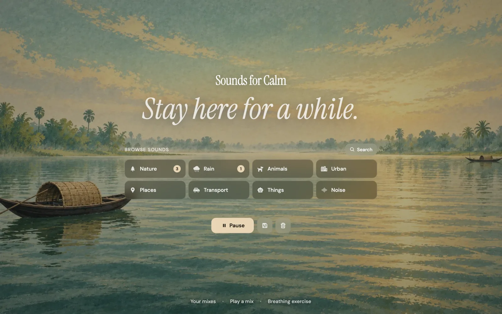

# Sounds



A compact ambient sound mixer for focus, relaxation, and breathing exercises.

## Features

- Layer ambient sounds and control their volume
- Save and reuse sound presets
- Guided breathing exercise

## Development

```bash
pnpm install
pnpm dev
```

## Deployment

Built for Cloudflare Pages.

- Build command: `pnpm build`
- Output directory: `dist`
- Website: [sounds.azmainadel.com](https://sounds.azmainadel.com)

## Credits and licenses

The ambient sound files come from [Moodist](https://github.com/remvze/moodist), which is available under the [MIT License](https://github.com/remvze/moodist/blob/main/LICENSE). Individual sounds may also carry their original Pixabay or CC0 licenses.
